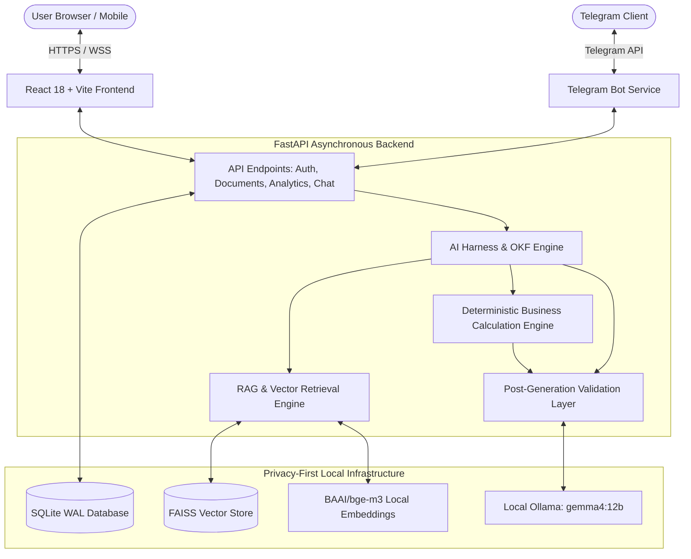

# 🧠 Enterprise Offline AI RAG & Business Analytics Platform

An enterprise-grade, privacy-first AI platform that combines **local Retrieval-Augmented Generation (RAG)** with a **deterministic Business Intelligence calculation engine** and **Organic Knowledge Framework (OKF)**.

Designed to operate **100% offline and on-premises**, ensuring company data, documents, and financial metrics never leave local infrastructure.

---

## 🌟 What This Project Does

This platform provides two dedicated, isolated workspaces alongside mobile and web interfaces:

### 1. 📂 AI Document Workspace (RAG Intelligence)
- **Deep Document Q&A**: Ingest and semantically search across enterprise files (PDF, DOCX, XLSX, CSV, TXT) with OCR text extraction.
- **Local Dense Embeddings**: Generates 1024-dimensional dense vector embeddings using local `BAAI/bge-m3` and indexes them into **FAISS** vector databases.
- **Context-Aware Synthesis**: Uses locally-hosted **Gemma 4 (12B)** via Ollama to generate grounded, cited answers strictly derived from uploaded documents.
- **Multi-Tenant Workspaces**: Complete isolation of document stores, indices, and conversations per workspace.
- **Real-Time Streaming**: Word-by-word streaming generation for immediate user feedback.

### 2. 📊 Business Analytics Workspace (Deterministic BI & Visuals)
- **Zero-Hallucination Financial Math**: Never lets the LLM perform mental arithmetic. All KPIs (Revenue, Cost, Profit, Margins, YoY/MoM growth, Moving averages, Outliers) are calculated deterministically via Python/Pandas.
- **Schema & Dimension Profiling**: Automatically inspects dataset schemas, column types, record counts, and categorical dimensions (`Product`, `Category`, `Region`, `Sales_Channel`) before deciding which analyses are possible.
- **Product Profitability & Ranking**: Generates exact ranked product breakdowns (Profit, Margin %, Contribution Share) and isolates business drivers from aggregate totals.
- **Power BI-Style Visualizations**: Automatically generates interactive dark-theme Plotly charts (Bar, Stacked Bar, Line, Area, Pie/Donut, Waterfall, and KPI indicator cards).
- **Strict Baseline Governance**: Never claims zero variance or stability without verified baselines. Reports `"Variance: Not calculated — baseline unavailable."` when comparative baselines are absent.

### 3. 🛡️ AI Harness & Organic Knowledge Framework (OKF)
- **Strict Math-Interpretation Separation**: Enforces strict separation between verified tabular arithmetic and executive interpretations.
- **Deterministic Post-Generation Validator**: Programmatically scans model outputs to intercept, sanitize, or correct unsupported variance, stability, or driver claims before delivery to the frontend.
- **Data Privacy & Trace Stripping**: Strips internal system prompts, backend instructions, and `<think>` reasoning traces from user-facing views.

### 4. 🌐 Multi-Source Summarization Engine
- **Universal Content Extractor**: Automatically detects content types:
  - **YouTube Videos**: Fetches and transcribes video transcripts directly.
  - **Web Articles**: Extracts clean reader-mode text from web URLs.
  - **Documents**: Summarizes raw text or uploaded documents.
- **Executive BI Formats**: Generates structured summaries with executive overviews, key takeaways, and action items.

### 5. 🤖 Telegram Bot Assistant
- Connects corporate users on the go via an interactive Telegram Bot.
- Query workspaces, upload documents, check analytics, and manage sessions securely from mobile.

---

## 🏗️ Architecture & Technology Stack



| Layer | Technologies |
| :--- | :--- |
| **Frontend** | React 18, Vite, Tailwind CSS, Lucide Icons, Plotly.js |
| **Backend** | Python 3.11, FastAPI, Uvicorn (HTTPS / TLS), Pydantic v2 |
| **LLM Inference** | Ollama with `gemma4:12b` (Local, Offline) |
| **Vector Search** | FAISS, LangChain, `BAAI/bge-m3` Dense Embeddings |
| **BI Engine** | Pandas, NumPy, Interquartile Range (IQR) Outlier Detection |
| **Database** | SQLite with Write-Ahead Logging (WAL) & ACID compliance |
| **Security** | JWT Bearer Authentication, Passlib / Bcrypt, End-to-end SSL/TLS |

---

## 📁 Repository Structure

```
rag.okf/
├── backend/
│   ├── api/                      # REST API endpoints (Auth, Analytics, Chat, Docs)
│   ├── core/                     # Database, security, and configuration settings
│   ├── models/                   # Pydantic schemas and database models
│   ├── services/
│   │   ├── analytics/            # Calculation engine, validator, and BI explainer
│   │   ├── harness/              # AI Harness, OKF engine, intent parser, privacy
│   │   ├── summarization/        # Web, YouTube, and text summarization engines
│   │   ├── document_processor.py # PDF/DOCX/OCR text extraction
│   │   ├── vector_store.py       # FAISS vector store management
│   │   ├── ollama_client.py      # Local Ollama client
│   │   └── rag_engine.py         # Retrieval-augmented generation pipeline
│   ├── telegram_bot/             # Telegram bot integration
│   ├── tests/                    # Pytest test suites (64 passing regression tests)
│   ├── create_admin.py           # Admin bootstrapping utility
│   ├── requirements.txt          # Python dependencies
│   └── main.py                   # FastAPI application entrypoint
├── frontend/
│   ├── src/
│   │   ├── components/           # UI components (Chat, Analytics, Sidebar, etc.)
│   │   ├── pages/                # Workspace views (Analytics, Documents, Login)
│   │   ├── lib/                  # API client and streaming handlers
│   │   └── App.jsx               # Main application routing
│   ├── package.json              # Frontend dependencies
│   └── vite.config.js            # Vite build & proxy configuration
├── certs/                        # SSL/TLS certificates (generated locally)
├── start.bat                     # Windows one-click startup script
├── .gitignore                    # Leak-proof git protection
└── README.md                     # Platform documentation
```

---

## 🚀 Getting Started

### Prerequisites
1. **Python 3.11+**
2. **Node.js 18+** & npm
3. **Ollama** installed with `gemma4:12b` pulled:
   ```bash
   ollama pull gemma4:12b
   ```

### 1. Environment Configuration
Copy the example environment configuration:
```bash
cp backend/.env.example backend/.env
```
Edit `backend/.env` with your desired configuration:
```ini
SECRET_KEY=your_generated_secret_key_here
ADMIN_PASSWORD=your_secure_admin_password
DEFAULT_LLM_MODEL=gemma4:12b
EMBEDDING_MODEL_NAME=BAAI/bge-m3
```

### 2. Backend Setup
```bash
cd backend
python -m venv .venv
.venv\Scripts\activate      # On Windows
pip install -r requirements.txt

# Create initial admin account
python create_admin.py

# Launch backend over HTTPS
python -m uvicorn main:app --app-dir backend --host 0.0.0.0 --port 30000 --ssl-keyfile certs/key.pem --ssl-certfile certs/cert.pem
```

### 3. Frontend Setup
```bash
cd frontend
npm install
npm run dev -- --host 0.0.0.0 --port 30001
```

---

## 🧪 Testing & Verification

The platform includes a test suite covering the AI Harness, calculation engine, RAG pipeline, and privacy guards:

```bash
python -m pytest backend/tests/ -v
```
**Current Status**: `64 passed, 0 failed (100% pass rate)`

---

## 🔒 Security & Privacy Notice
- **Zero External API Calls**: Document processing, vector indexing, and LLM inferences remain strictly on-device.
- **Sensitive Files Protected**: All `.env`, `certs/`, database files (`*.db`), vector stores (`vector_db/`), user upload directories (`uploads/`), and logs are strictly excluded from version control via [`.gitignore`](file:///.gitignore).
